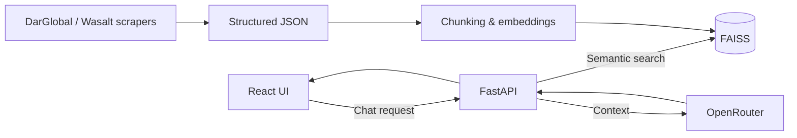

# PropertyIQ - DarGlobal & Wasalt AI Assistant

PropertyIQ is a grounded real-estate RAG chatbot that answers questions using publicly accessible DarGlobal and Wasalt web content. It never treats missing context as evidence and keeps original source URLs for citation.

## Features

- Public website scraping with robots.txt checks, rate limiting, retries, cleaning and deduplication
- FAISS vector retrieval with Sentence Transformers
- Grounded OpenRouter chat completions with model fallback
- Source citations and relevance scores
- Browser-persisted conversation history with thread switching and deletion
- Responsive React, TypeScript and Tailwind-inspired luxury interface
- Docker Compose deployment and Render configuration
- Health, status, scrape and rebuild APIs

## Architecture



## Local setup

```powershell
Copy-Item .env.example .env
py -m pip install -r backend/requirements.txt
cd backend
python -m uvicorn app.main:app --reload --port 8000
```

In a second terminal:

```powershell
cd frontend
npm install
npm run dev
```

Open `http://localhost:5173`.

## Docker

```powershell
Copy-Item .env.example .env
docker compose up --build
```

- Frontend: `http://localhost:3000`
- API: `http://localhost:8000`
- Docs: `http://localhost:8000/docs`

## Scraping and knowledge rebuild

```powershell
cd backend
python -m app.scrape_cli --limit 30 --rebuild
```

Scraping is limited to publicly accessible pages allowed by robots.txt and is best-effort. If a site blocks requests or changes markup, no fabricated records are added.

Administrative requests:

```powershell
curl.exe -X POST "http://localhost:8000/api/scrape?limit=30" -H "X-Admin-Token: $env:ADMIN_TOKEN"
curl.exe -X POST "http://localhost:8000/api/knowledge/rebuild" -H "X-Admin-Token: $env:ADMIN_TOKEN"
```

## Environment variables

| Variable | Purpose |
|---|---|
| OPENROUTER_API_KEY | Server-side OpenRouter credential |
| OPENROUTER_MODEL | Preferred free model |
| OPENROUTER_FALLBACK_MODELS | Comma-separated model fallbacks |
| OPENROUTER_TIMEOUT | Request timeout in seconds |
| ADMIN_TOKEN | Optional protection for scrape/rebuild endpoints |
| CORS_ORIGINS | Comma-separated allowed frontend origins |
| DATA_DIR | Scraped JSON and FAISS storage directory |

Never commit `.env` or expose the API key to frontend code.

## API

- `GET /health`
- `GET /api/status` (includes indexed source websites and document count)
- `GET /api/sources`
- `POST /api/chat` with `{ "message": "...", "history": [] }`
- `POST /api/scrape`
- `POST /api/knowledge/rebuild`

## Tests

```powershell
cd backend
py -m pytest -q
cd ../frontend
npm run build
```

## Deployment

1. Push the repository to GitHub.
2. In Render, create a Blueprint from `render.yaml`.
3. Set `OPENROUTER_API_KEY` and frontend `CORS_ORIGINS`.
4. Add a managed persistent disk or external storage for `/app/data` in production if available. The free tier is ephemeral, so the scraped JSON and FAISS index may be lost after restarts. Re-run the scrape/rebuild CLI or endpoint after deployment.
5. Configure the frontend API service URL to point to the backend when not using the supplied same-origin proxy.

No live URL should be claimed until the deployed endpoint is tested successfully.

## Limitations

- Public web structures change and scraping can be blocked.
- Free OpenRouter models and quotas vary.
- Availability and prices are not inferred.
- Browser session history is in-memory only.
- Render's free tier may not preserve local vector storage.
